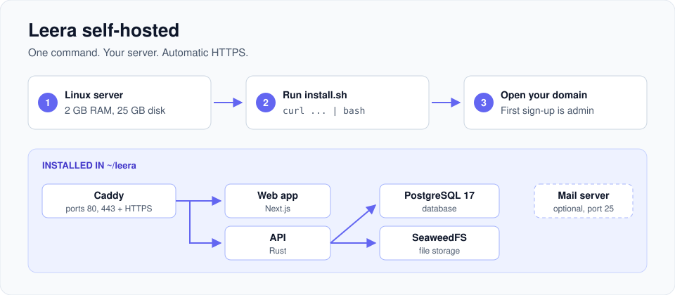

# Leera self-hosted



Run Leera on your own server with one command.

> Files here are published with each Leera release. Edit your copy in `~/leera`, not this repository.

## Requirements

| Need | Details |
| --- | --- |
| Server | Linux, root or `sudo` |
| Memory | 2 GB RAM |
| Disk | 25 GB (updates need 3 GB free) |
| Ports | 80 and 443 free. 25 only for the [mail server](#receive-project-email) |
| HTTPS | Domain with an A record already pointing at the server |
| Docker | Not needed. The installer adds it |

## Install with an AI agent (Claude Code, Codex, Cursor or other)

<details>
<summary>Show the prompt</summary>

````text
Install Leera (self-hosted) for me, end to end.

Work through these phases in order. Stop and wait for me before anything that
costs money or changes DNS.

PHASE 1: Ask me where it should run
Ask which of these I want, and do nothing else until I answer:
  (a) AWS: you create the EC2 instance and the Route 53 record
  (b) GCP: you create the Compute Engine VM and the Cloud DNS record
  (c) A server I already have: I give you the host and SSH user
  (d) This machine: local evaluation only, no domain, plain HTTP

PHASE 2: Get access, without me pasting secrets
Never ask me to type a password, private key, or access key into this chat.
Check what you already have:
  AWS: aws sts get-caller-identity
  GCP: gcloud auth list ; gcloud config get-value project
  SSH: ssh -o BatchMode=yes <user>@<host> true
If a check fails, stop and tell me the exact command to run in my own terminal
(aws configure sso, gcloud auth login, ssh-add ~/.ssh/<key>), then wait for me.
Then ask for the region/project/zone, and the domain I want to use, for
example pm.example.com. Confirm I actually control that domain's DNS.

PHASE 3: Show me a priced plan before you build anything
List what you will create and the rough monthly cost, then wait for a yes:
  - one Linux VM: 2 vCPU, 4 GB RAM, 25 GB disk, current Ubuntu LTS
    (AWS t3.medium or GCP e2-medium is the right size to start)
  - a firewall rule opening ONLY 22, 80 and 443
  - a static IP, so the address survives a reboot
  - one DNS A record for my domain pointing at that IP
Create nothing outside that list. Do not modify or delete existing VPCs,
instances, security groups or DNS records that you did not create. If the
sensible path needs an existing resource, name it and ask me first.

PHASE 4: Build it
Provision exactly what I approved, and tag every resource "leera-selfhost" so
it is easy to find and to tear down later. Report the resource IDs as you go.

PHASE 5: Wait for DNS before installing. This one matters.
The installer requests an HTTPS certificate on first start, and Let's Encrypt
fails if the domain does not already resolve to the server. Do not skip ahead.
Poll until `dig +short <domain>` returns the VM's IP from more than one
resolver, and only then continue. If it has not propagated within 10 minutes,
tell me. Do not install anyway and leave me with a broken certificate.

PHASE 6: Install
Ask whether I want to give the installer my email (it is used to register
my licence and to help if the install fails). If I do, add LEERA_EMAIL=<email>
to the command below; if not, leave it out. SSH to the server and run:
  LEERA_DOMAIN=<domain> LEERA_INSTALL_DOCKER=yes \
    bash -c "$(curl -fsSL https://raw.githubusercontent.com/leera-app/leera-selfhost/main/install.sh)"
Docker does not need to be installed first; the installer handles it. This
pulls images and takes a few minutes.

PHASE 7: Prove it works. Do not just assert it.
  - cd ~/leera && ./install.sh --status
  - curl -sS -o /dev/null -w '%{http_code}' https://<domain>   → expect 200
  - curl -sSI https://<domain>                                 → no TLS error
If any of those fail, read the logs before reporting anything:
  cd ~/leera && docker compose logs --tail=100 caddy api web
Diagnose and fix it, or tell me plainly what is broken. Never report success
you have not verified.

PHASE 8: Hand it over
Tell me:
  - the URL, and that THE FIRST ACCOUNT CREATED BECOMES THE ADMINISTRATOR,
    so I should sign up immediately, before anyone else reaches it
  - that everything lives in ~/leera, including the .env holding my secrets
  - how to back up: cd ~/leera && ./install.sh --backup, and that a backup
    only counts once it is copied OFF the server
  - how to upgrade: cd ~/leera && ./install.sh --upgrade
  - every resource you created, so I can delete it if I change my mind

IF YOU HIT A PERMISSION WALL
Do not work around it, and do not quietly give up. Tell me:
  - what you tried, and the exact error
  - which specific IAM permission or role is missing
  - the fastest way for me to grant it: as a command I can paste, AND as
    click-by-click console steps, since I may not have CLI admin rights
  - or, if I would rather do that one step myself, exactly what to click
Then wait for me. A stalled install I can finish beats a half-built one.
````

</details>

## Install it yourself

Interactive:

```bash
curl -fsSL https://raw.githubusercontent.com/leera-app/leera-selfhost/main/install.sh | bash
```

Unattended:

```bash
LEERA_DOMAIN=pm.example.com LEERA_INSTALL_DOCKER=yes bash -c "$(curl -fsSL https://raw.githubusercontent.com/leera-app/leera-selfhost/main/install.sh)"
```

Open the printed URL. **The first account created becomes the administrator.**

| Setting | Use |
| --- | --- |
| `LEERA_DOMAIN` | Your domain, for HTTPS. Blank means `http://localhost` |
| `LEERA_EMAIL` | Optional. Registers your licence and lets us help if the install fails. Never marketing |
| `LEERA_INSTALL_DOCKER` | `yes` or `no` |
| `LEERA_HOME` | Install folder. Default `~/leera` |
| `LEERA_VERSION` | Pin a version, e.g. `selfhost-0.1.2` |

## Behind nginx or another proxy

If ports 80 and 443 are taken, the installer offers external proxy mode. Leera then listens on `127.0.0.1:8080`.

```bash
LEERA_PROXY_MODE=external LEERA_DOMAIN=pm.example.com bash -c "$(curl -fsSL https://raw.githubusercontent.com/leera-app/leera-selfhost/main/install.sh)"
```

```bash
sudo cp ~/leera/nginx-leera.conf /etc/nginx/sites-available/leera
sudo ln -s /etc/nginx/sites-available/leera /etc/nginx/sites-enabled/leera
sudo nginx -t && sudo systemctl reload nginx
sudo certbot --nginx -d pm.example.com
```

| Note | Details |
| --- | --- |
| Routes | Proxy everything to the one address. Do not copy Leera's routes |
| Setup wizard | Runs on `127.0.0.1:7777`. Use `ssh -L 7777:127.0.0.1:7777 you@server` |
| Proxy in a container | Set `LEERA_PROXY_BIND=0.0.0.0:8080` in `~/leera/.env` and firewall it |
| Mail server | Not supported in this mode |

## Receive project email

Turns incoming mail into tickets. Off by default.

1. Point an A record for `mx.example.com` at this server.
2. Add to `~/leera/.env`, then run the installer:

   ```bash
   LEERA_INBOUND_MX=on
   LEERA_MX_HOSTNAME=mx.example.com
   ```

   ```bash
   cd ~/leera && ./install.sh
   ```

3. Open port 25 in your firewall.
4. In the app: **Instance Settings > Email > Inbound project email**, choose **This server receives mail directly**, then add the DNS records it lists.

| Note | Details |
| --- | --- |
| Turn off | `LEERA_INBOUND_MX=off`, then `./install.sh` |
| Port 25 blocked | Choose **An inbound-parse provider forwards to us** instead |
| `COMPOSE_PROFILES` | Do not edit. The installer manages it |

## Everyday commands

| Task | Command |
| --- | --- |
| Back up | `cd ~/leera && ./install.sh --backup` |
| Restore | `cd ~/leera && ./install.sh --restore /path/to/backup` |
| Upgrade | `cd ~/leera && ./install.sh --upgrade` |
| Status | `cd ~/leera && ./install.sh --status` |
| Logs | `cd ~/leera && docker compose logs -f api web` |

Upgrade takes a backup first. Copy backups off the server.

## What a backup holds

| File | Why |
| --- | --- |
| `leera.dump` | Database |
| `secret_key` | Decrypts stored credentials. A dump without it cannot be restored |
| `.env` | Container passwords |
| `storage/` | Uploaded files |

## What gets installed

| Service | Role |
| --- | --- |
| `caddy` | Proxy and automatic HTTPS |
| `web` | Web app |
| `api` | API |
| `migrate` | Database migrations, run on each upgrade |
| `db` | PostgreSQL 17 |
| `objects` | SeaweedFS file storage |
| `mx` | Mail server, only with `LEERA_INBOUND_MX=on` |

Images: `ghcr.io/leera-app/leera-api:selfhost` and `ghcr.io/leera-app/leera-web:selfhost`. Do not use `latest`.
