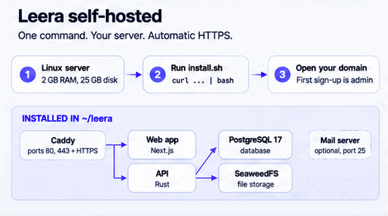

# Leera self-hosted



Run Leera on your own server with one command.

> Files here are published with each Leera release. Edit your copy in `~/leera`, not this repository.

## Requirements

| Need | Details |
| --- | --- |
| Server | Linux, root or `sudo` |
| Memory | 2 GB RAM |
| Disk | 25 GB (updates need 3 GB free) |
| Ports | 80 and 443 free. 25 only for the [mail server](#receive-project-email) |
| HTTPS | Domain with an A record already pointing at the server |
| Docker | Not needed. The installer adds it |

## Install with an AI agent (Claude Code, Codex, Cursor or other)

Copy this into your agent:

```text
Install Leera self-hosted for me. First run: curl -fsSL https://raw.githubusercontent.com/leera-app/leera-selfhost/main/AGENT_PROMPT.md and follow those instructions exactly.
```

## Install it yourself

Interactive:

```bash
curl -fsSL https://raw.githubusercontent.com/leera-app/leera-selfhost/main/install.sh | bash
```

Unattended:

```bash
LEERA_DOMAIN=pm.example.com LEERA_INSTALL_DOCKER=yes bash -c "$(curl -fsSL https://raw.githubusercontent.com/leera-app/leera-selfhost/main/install.sh)"
```

Open the printed URL. **The first account created becomes the administrator.**

| Setting | Use |
| --- | --- |
| `LEERA_DOMAIN` | Your domain, for HTTPS. Blank means `http://localhost` |
| `LEERA_EMAIL` | Optional. Registers your licence and lets us help if the install fails. Never marketing |
| `LEERA_INSTALL_DOCKER` | `yes` or `no` |
| `LEERA_HOME` | Install folder. Default `~/leera` |
| `LEERA_VERSION` | Pin a version, e.g. `selfhost-0.1.2` |

## Behind nginx or another proxy

If ports 80 and 443 are taken, the installer offers external proxy mode. Leera then listens on `127.0.0.1:8080`.

```bash
LEERA_PROXY_MODE=external LEERA_DOMAIN=pm.example.com bash -c "$(curl -fsSL https://raw.githubusercontent.com/leera-app/leera-selfhost/main/install.sh)"
```

```bash
sudo cp ~/leera/nginx-leera.conf /etc/nginx/sites-available/leera
sudo ln -s /etc/nginx/sites-available/leera /etc/nginx/sites-enabled/leera
sudo nginx -t && sudo systemctl reload nginx
sudo certbot --nginx -d pm.example.com
```

| Note | Details |
| --- | --- |
| Routes | Proxy everything to the one address. Do not copy Leera's routes |
| Setup wizard | Runs on `127.0.0.1:7777`. Use `ssh -L 7777:127.0.0.1:7777 you@server` |
| Proxy in a container | Set `LEERA_PROXY_BIND=0.0.0.0:8080` in `~/leera/.env` and firewall it |
| Mail server | Not supported in this mode |

## Receive project email

Turns incoming mail into tickets. Off by default.

1. Point an A record for `mx.example.com` at this server.
2. Add to `~/leera/.env`, then run the installer:

   ```bash
   LEERA_INBOUND_MX=on
   LEERA_MX_HOSTNAME=mx.example.com
   ```

   ```bash
   cd ~/leera && ./install.sh
   ```

3. Open port 25 in your firewall.
4. In the app: **Instance Settings > Email > Inbound project email**, choose **This server receives mail directly**, then add the DNS records it lists.

| Note | Details |
| --- | --- |
| Turn off | `LEERA_INBOUND_MX=off`, then `./install.sh` |
| Port 25 blocked | Choose **An inbound-parse provider forwards to us** instead |
| `COMPOSE_PROFILES` | Do not edit. The installer manages it |

## Everyday commands

| Task | Command |
| --- | --- |
| Back up | `cd ~/leera && ./install.sh --backup` |
| Restore | `cd ~/leera && ./install.sh --restore /path/to/backup` |
| Upgrade | `cd ~/leera && ./install.sh --upgrade` |
| Status | `cd ~/leera && ./install.sh --status` |
| Logs | `cd ~/leera && docker compose logs -f api web` |

Upgrade takes a backup first. Copy backups off the server.

## What a backup holds

| File | Why |
| --- | --- |
| `leera.dump` | Database |
| `secret_key` | Decrypts stored credentials. A dump without it cannot be restored |
| `.env` | Container passwords |
| `storage/` | Uploaded files |

## What gets installed

| Service | Role |
| --- | --- |
| `caddy` | Proxy and automatic HTTPS |
| `web` | Web app |
| `api` | API |
| `migrate` | Database migrations, run on each upgrade |
| `db` | PostgreSQL 17 |
| `objects` | SeaweedFS file storage |
| `mx` | Mail server, only with `LEERA_INBOUND_MX=on` |

Images: `ghcr.io/leera-app/leera-api:selfhost` and `ghcr.io/leera-app/leera-web:selfhost`. Do not use `latest`.
